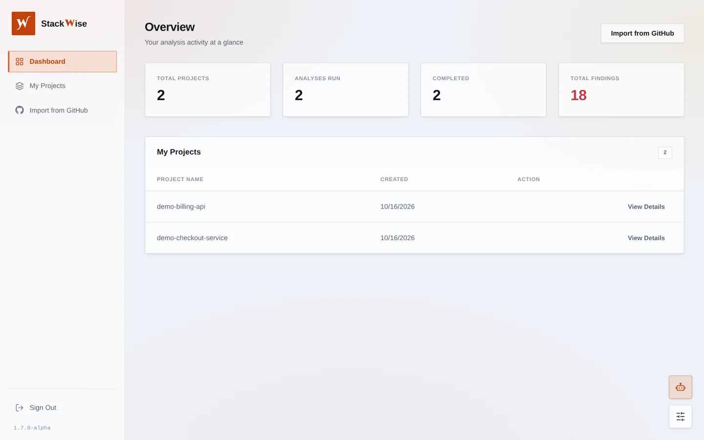
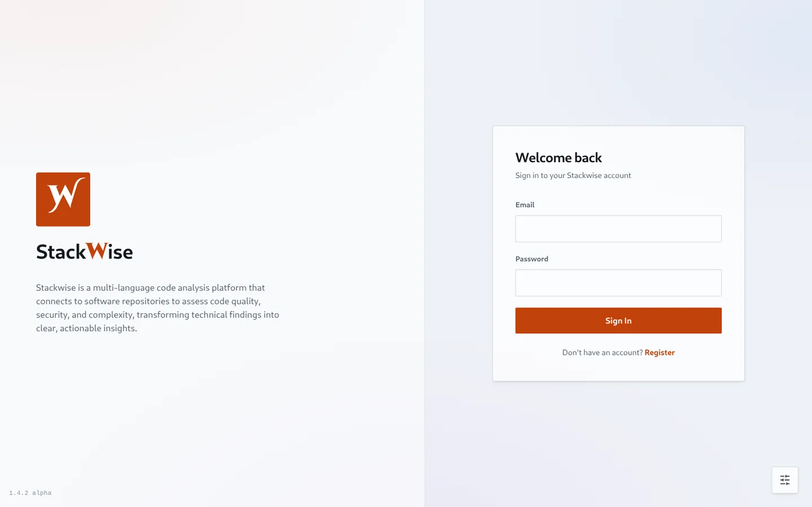
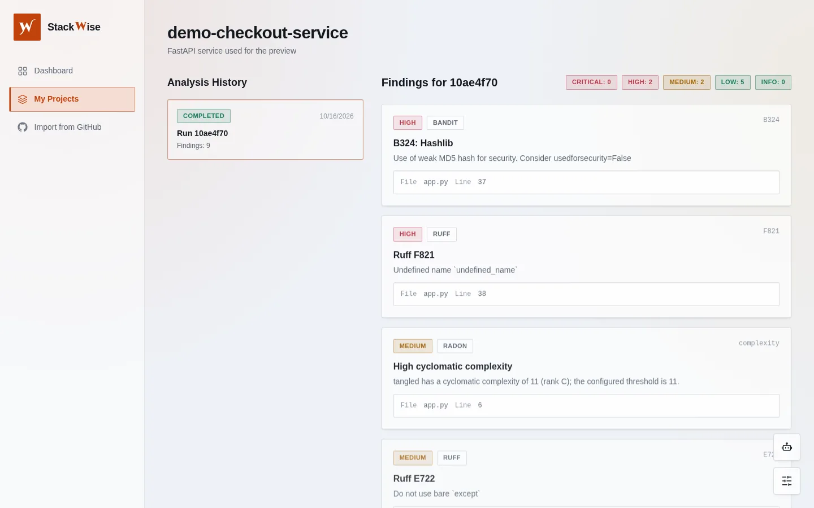
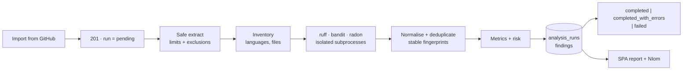

# Stackwise


**Code quality, security and complexity analysis that reads like a report instead of a log.**
Import a repository straight from GitHub, and Stackwise turns raw
analyzer output into a browsable report, then hands it to **NIom**, an agent that explains what the
findings mean.

> **This repository is Stackwise Main — the single, complete version of the project.** Backend, SPA
> and analysis engine live together here, and this is the copy that is developed and released. There
> is no second repository to keep in step: what you read below is what runs.

- **[Running it locally](#running-it-locally)** — prerequisites, environment, commands.
- **[Install it as an app](#install-it-as-an-app-pwa)** — Android, iOS/iPadOS, and what works
  offline.
- **[Deploying](#deploying)** — the manual procedure, including Supabase.



---

## Contents

- [What it is](#what-it-is)
- [Running it locally](#running-it-locally)
- [The product on screen](#the-product-on-screen)
- [Install it as an app (PWA)](#install-it-as-an-app-pwa)
- [NIom, the findings agent](#niom-the-findings-agent)
- [How a run works](#how-a-run-works)
- [Architecture](#architecture)
- [The analysis engine](#the-analysis-engine)
- [API](#api)
- [Data model](#data-model)
- [Settings](#settings)
- [Design system](#design-system)
- [How it is built](#how-it-is-built)
- [Deploying](#deploying)
- [Status](#status)
- [Versioning](#versioning)
- [Roadmap](#roadmap)

---

## What it is

Two parts that talk over a REST API:

| Part | What it is |
|---|---|
| `app/` | FastAPI backend — accounts, projects, the analysis pipeline, the JSON API |
| `frontend/` | React + TypeScript SPA — flat glass UI, orange brand, light/dark themes, EN/ES |

What a user gets out of it:

- **A report per analysis**, not a wall of tool output: severity and category counts, a findings list
  with file/line references, and a history of every run of a project.
- **Three analyzers with one vocabulary**: [ruff](https://docs.astral.sh/ruff/) for lint,
  [bandit](https://bandit.readthedocs.io/) for security and [radon](https://radon.readthedocs.io/) for
  complexity and maintainability, normalised into one finding shape with a stable fingerprint.
- **Objective numbers kept apart from opinion**: measured metrics on one side, a versioned heuristic
  risk indicator on the other — and `null` (not `0`) when a signal is missing.
- **NIom explaining the result** in the language the user asks in, quoting the findings it was given.
- **Projects and accounts**: email/password or Google/GitHub sign-in, per-owner isolation on every
  resource, and GitHub import for private repositories the user's own token can read.

Only Python code is analyzed today: all three bundled analyzers are Python-only.

---

## Running it locally

Two processes — the API and the Vite dev server, which proxies `/api` to the API — over one SQLite
file. No Docker, Redis or message broker is involved: analyses run inside the API process.

### Prerequisites

| Tool | Developed against | Notes |
|---|---|---|
| Python | 3.14 (3.12+) | the backend and the analysis engine |
| Node.js | 26 (20+) | the SPA |
| `ruff`, `bandit`, `radon` | pinned in `requirements.txt` | installed *with* the backend, never separately: the engine records the version it executed per run |

### 1. Backend

```bash
python -m venv venv
source venv/bin/activate                 # Windows: venv\Scripts\activate
pip install -r requirements.txt

cp .env.example .env                     # then edit it — see step 3
python init_db.py                        # creates the tables in ./stackwise.db
uvicorn app.main:app --reload --port 8001
```

To poke at the app without registering, create a throwaway account in the same database:

```bash
python create_admin.py you@example.com            # prompts for the password (hidden)
python create_admin.py you@example.com --reset    # replace it later
```

It writes an **ordinary** account — Stackwise has no administrator role, every account reaches only
its own data — and it holds no credential of its own: the address and password come from whoever runs
it, the password is never echoed and only its bcrypt hash is stored. The address must be one the API
accepts as an email, which rules out reserved domains like `.test` or `.local`.

The API answers on `http://localhost:8001`; `GET /health` works even when the database does not.

`python init_db.py` is the create-all path used in development. A deployment applies the Alembic
baseline instead — `alembic upgrade head` — because migrations are the only path that survives a
schema change (see [Data model](#data-model)).

### 2. Frontend

```bash
cd frontend
npm install
npm run dev                              # http://localhost:3000, /api proxied to :8001
```

Open `http://localhost:3000`, register, connect a GitHub account and import a repository to analyse.
The Vite dev server serves the SPA from port 3000 and forwards `/api` to 8001, so nothing has to be
configured to run the two together. If the API lives elsewhere, set `VITE_API_URL` when building.

### 3. Configuration

`SECRET_KEY` has **no default**: the application refuses to start rather than sign tokens with a key
somebody could guess. A local one can be generated with:

```bash
python -c "import secrets; print(secrets.token_urlsafe(48))"
```

Everything else has a working default and is documented inline in [`.env.example`](.env.example) —
database URL, public origins, the optional OAuth providers, the analysis ceiling, and the two ways to
run the findings agent. The full list, with what each variable does, is in
[Settings](#settings).

Social sign-in needs no code to switch on: fill `GOOGLE_CLIENT_ID`/`_SECRET` or
`GITHUB_CLIENT_ID`/`_SECRET` and the buttons appear (see [OAuth sign-in](#oauth-sign-in-google-github) for
the two consoles and the redirect URI to register). To exercise the whole round-trip *before* those
credentials exist, set `DEV_OAUTH_MOCK=true`, restart the API and use the third button on the
sign-in form.

### 4. Tests and a production build

```bash
pytest                                   # 317 tests, ~80s (it hashes passwords for real)
npm run build --prefix frontend          # tsc + vite build → frontend/dist
npm run preview --prefix frontend        # serves that build (also the PWA) on :4173
```

The suite runs the **real** `ruff`/`bandit`/`radon` binaries against a throwaway SQLite database, so a
missing analyzer fails the tests by design rather than being papered over. `npm run build` is
type-checked (`tsc` runs first), which is what keeps the SPA's typed dictionary and API types honest.

---

## The product on screen

### Sign in

Split layout — brand pitch on one side, the credential form on the other — with the release mark
bottom-left and the floating controls bottom-right.



### Overview

The dashboard is one round trip: totals per user, the completed/analyses split, findings by severity
and the project table.


### A project and its findings

Left: the analysis history of one project (status, source, date, finding count). Right: the selected
run — severity chips and the finding cards, each with its tool, rule id, file and line.



### The chrome that is always there

- bottom-right: the settings drawer (theme, language, the account's sign-in methods, contact) and,
  above it, **NIom** — the robot button only exists while a session does;
- bottom-left: the **release version** of the running build;
- top (when it matters): a single banner that reports a lost connection, or an update that is waiting
  to be applied.

### On a phone

Below 768px the 256px sidebar becomes a drawer behind a menu button, so the content keeps the full
width of the screen; the drawer closes on navigation, on Escape or on the backdrop. Controls grow to
a 44px touch target, text fields to 16px so iOS does not zoom on focus, and every fixed element
respects the notch and home-indicator insets (`env(safe-area-inset-*)`). Wide tables — findings, run
history, projects — scroll inside their card instead of overflowing the page. The layout is the same
one, not a second mobile app.

---

## Install it as an app (PWA)

The SPA is an installable Progressive Web App: `frontend/vite.config.ts` wires
[`vite-plugin-pwa`](https://vite-pwa-org.netlify.app/), the manifest is a real file
([`frontend/public/manifest.webmanifest`](frontend/public/manifest.webmanifest)), and the service
worker is generated at build time — so **the PWA only exists in a production build**
(`npm run build` + `npm run preview`, or a deployed `dist/`), not in `npm run dev`, where a worker
over the dev server would serve stale bundles.

### Android (Chrome / Edge / Samsung Internet)

1. Open the deployed URL over **HTTPS**.
2. Chrome shows an install prompt; otherwise use the ⋮ menu → **Add to Home screen** / **Install app**.
3. The icon (`icon-192.png`, `icon-512.png`) opens the app in its own window, without browser chrome.

### iPhone and iPad (Safari)

1. Open the deployed URL in **Safari** (Chrome on iOS cannot install a web app).
2. Tap **Share** → **Add to Home Screen** → **Add**.
3. Launch it from the home-screen icon: it opens full-screen with the `apple-touch-icon.png` tile,
   `Stackwise` as the label, and the standalone status bar.

There is no App Store build and none is planned — this is the same web application, installed.

### What is cached, and what that means offline

| | |
|---|---|
| Pre-cached | the app shell: HTML, JS, CSS, icons, manifest |
| Cached on use | the two Google Fonts hosts (stylesheets and the webfont itself) |
| **Never cached** | everything under `/api/` — analyses, findings, projects, the chat — and the session token lives in `localStorage`, not in a cache |

So an installed Stackwise opens without a network, and immediately says so: it shows the last rendered
shell plus an explicit *"You're offline. Analyses, findings and the chat need the backend."* banner
with a **Retry** button. **Analysis does not work offline** and the UI never implies it does. Nothing
authenticated is stored in the cache, so a shared device cannot leak another user's findings through
the worker.

An update is applied only when the user accepts it: a new service worker waits
(`registerType: 'prompt'`) and the banner offers **Reload** — so a run being watched or a half-filled
form is never discarded underneath you.

### Not verified on real hardware

The PWA build, manifest, icon files, service worker and the iOS meta tags are in place and verified in
a **desktop browser** (installability, worker registration, cached shell, network-only `/api`). A
physical iPhone/iPad has not been used to test the *Share → Add to Home Screen* flow, and neither has
a physical Android device — install these and treat that as the acceptance check.

---

## NIom, the findings agent

NIom is the chat behind the robot button. It answers questions about the analysis in scope — "what
should I fix first?", "why is this a high finding?", "what is radon complaining about in `app.py`?" —
grounded in the caller's own findings, quoted with `path:line`.

How it is put together:

| Piece | Where | What it does |
|---|---|---|
| Seam | `app/agent/backend.py` | `AgentBackend`: name, model, `unavailable_reason()`, `complete()`. Everything else is written against this |
| Runtime A — local | `app/agent/qwen.py` | Qwen2.5-0.5B-Instruct through `transformers`, loaded on first use, one generation at a time, off the event loop. Needs `pip install -r requirements-agent.txt` |
| Runtime B — hosted | `app/agent/cloudflare.py` | A model on **Cloudflare Workers AI** over its REST API. Nothing to install: one HTTPS call per turn, `CLOUDFLARE_ACCOUNT_ID` + `CLOUDFLARE_API_TOKEN` |
| Prompt | `app/agent/prompt.py` | Pure functions: severity-ordered findings → a digest bounded by count and characters, plus a system turn the client cannot rewrite. Findings are quoted data, and the prompt says so |
| Registry | `app/agent/registry.py` | Maps the configured backend name (`qwen`, `cloudflare`, `none`) onto an implementation |
| Service | `app/agent/service.py` | Resolves the scope (a given run, else the project's latest finished one), enforces ownership, reads the capped findings, calls the backend |
| Endpoints | `app/api/v1/agent.py` | `GET /agent/status`, `POST /agent/chat`, per-user rate limit |

Pick one with `AGENT_BACKEND`. `qwen` keeps everything on your own machine; `cloudflare` runs on a
managed GPU and is what a small container or a serverless deployment can actually afford — the
reference model is `@cf/qwen/qwen2.5-coder-32b-instruct` (32k context, billed per token),
overridable with `CLOUDFLARE_MODEL_ID`. The two are interchangeable by design: nothing above the seam
knows which one answered, and the answer itself reports it (`backend`, `model` in the response).

The account id is the 32-character one in the dashboard URL — not the account e-mail and not a URL: a
value that is neither is refused before any request exists (it is interpolated into the request path),
and the same sentence is written to the startup log once instead of waiting to be discovered as a 404.
`curl -s localhost:8001/api/v1/agent/status` is the check: it answers with the runtime and the model
when the pair works, and with the setting to fix when it does not.

Either way the feature is honest about what it is running: with no runtime available, `/agent/status`
reports `available: false` with the reason and the chat answers `503` — NIom says in its own voice
that it cannot read the findings yet. Nothing is ever generated without a model behind it, and the
actionable reason stays in the endpoint (where an operator reads it) rather than in the user's chat.

When the hosted backend is asked, its token travels in the `Authorization` header of a request made
**by the API process** and nowhere else: not in a `VITE_*` variable, not in a response, not in a log.
A failure becomes a short sanitised reason — the reason names the setting, never its value, and the
token is scrubbed from any upstream error text before it is quoted.

Scope and bounds: a request is grounded in the caller's findings, capped by
`AGENT_MAX_CONTEXT_FINDINGS` / `AGENT_MAX_CONTEXT_CHARS`; conversation size, answer length and time
are capped by `AGENT_MAX_MESSAGES`, `AGENT_MAX_MESSAGE_CHARS`, `AGENT_MAX_NEW_TOKENS` and
`AGENT_TIMEOUT_SECONDS`, and requests are rate limited per user.

### The answer arrives while it is being written

`POST /agent/chat` returns the whole answer, which is the simplest thing for a script to call.
`POST /agent/chat/stream` returns the same answer as server-sent events — `meta` (which runtime is
answering, and what it was given), then a `delta` per fragment, then `done` with the complete text —
and that is what the SPA uses, because a chat that stays silent for thirty seconds does not look
like it is working.

The distinction is real, not decorative: the screen can tell *request sent* from *server accepted it*
from *text is arriving* from *finished*, because each of those is a different event on the wire. A
failure before the first byte is still an HTTP status (`422` bad conversation, `429` rate limit,
`503` runtime unavailable); a failure inside the stream cannot change the status line any more, so it
arrives as an `error` event with the same sanitised reason. Stopping the request (the **Stop** button)
aborts the `fetch`, which closes the upstream connection, so a user who gives up stops paying for
tokens.

Only the hosted runtime streams token by token. A runtime that cannot — the local checkpoint today —
yields its whole answer as a single fragment, which is all it can honestly report; the endpoint, the
client and the screen are unchanged either way.

### Its body

NIom has a small robot, drawn as one inline `<svg>` and animated in CSS (`components/Robot.tsx` plus
the `.sw-robot*` block in `index.css`) — no image, no font, no animation library, sharp at any size
and recoloured by the theme tokens.

It is a *state machine wired to the request*, not a decoration on a timer — with one clock of its own,
the nap, because the one thing the server cannot tell it is that the user has stopped reading:

| State | When | What it shows |
|---|---|---|
| `idle` | nothing happening | slow breathing, a blink every ~5s, a slight head sway |
| `attentive` | the composer has focus or text, and the user is not thinking about something else | taller eyes, head tilted toward the input, faster breath |
| `thinking` | a request is out and no text has arrived | eyes looking away, three dots rising, the chest LEDs pulsing, the antenna lit |
| `typing` | there is an answer still being written | a small laptop slides out, arms alternate on the keyboard, a caret blinks on the code |
| `success` | the answer completed | eyes close into a smile, one nod, an accent flash |
| `error` | the request failed | eyes narrowed and tilted, one short shake, the antenna in the alert colour |
| `user-sent` | the moment the message goes | a short nod, then straight into thinking |
| `sleeping` | a minute with the panel open and no interaction at all | eyes closed, head down and tilted, the antenna drooped, LEDs out, three "z"s drifting up |
| `wake` | any interaction while it was asleep | the head comes back up with a small overshoot and the eyes open wide |

The answer is *written*, not pasted: the server's fragments are appended to a growing prefix that a
tick reveals at reading pace (`hooks/usePacedText.ts`), so a runtime that hands back a whole paragraph
in one frame still types it out — and the turn is only committed once the text has actually been
written, so the bubble never jumps from half a sentence to the whole one. The record is never
rewritten on the way: what is rendered is always a prefix of what arrived.

The nap is armed only while the panel is open and nothing is in flight, and every interaction —
typing, the pointer over the panel, scrolling the transcript, sending — re-arms it from scratch.
Anything that touches it while it sleeps wakes it with the `wake` pose instead of a jolt, and a
**Stop** while the model is writing returns the robot to rest with the partial answer kept and marked
*Cancelled* — nothing failed, so nothing looks wrong.

Pointer hover (over the head) is CSS only and lives behind `@media (hover: hover)`, so a touch screen
never depends on an event that cannot fire.

Accessibility: the figure is `aria-hidden` and never focusable — what the agent is doing is said in
words by the chat's own status line (`role="status"`), which is the accessible source of truth, so a
screen reader is never announced a moving face. Under `prefers-reduced-motion` every animation
collapses to nothing and the states remain readable as static poses (dots out, laptop out, eyes
narrowed, smile drawn). A background tab pauses the animation. The robot is always drawn in the chat
header — it is the status of the answer, not decoration you can turn off.

---

## How a run works



1. A user signs up (email/password, Google or GitHub) and imports a GitHub repository; that import
   creates the project and starts its first run.
2. `POST /projects/from-repo` downloads the repository's zipball with the caller's own GitHub token,
   spools it to a temp file, writes a `pending` run and returns `201` immediately.
3. The engine runs as a background task: extract safely → inventory → run the analyzers under
   explicit limits → normalise and deduplicate findings → compute metrics → compute heuristic risk →
   persist everything in one transaction → mark the run `completed` (or `completed_with_errors` when
   one analyzer failed, or `failed` with a category and a sanitised message).
4. The SPA shows the history and, for the selected run, its findings. Status is not polled live:
   reloading the project shows the current state.

---

## Architecture

```
Stackwise/
├── app/                    FastAPI backend
│   ├── main.py             app instance, CORS, /health, /api/v1 router
│   ├── api/
│   │   ├── deps.py         auth + ownership dependencies (current user, owned project/run)
│   │   └── v1/             auth, oauth, github, projects, analyses, dashboard, agent, health
│   ├── core/               settings, bcrypt + JWT + OAuth state, rate limiter
│   ├── db/                 async engine + session, declarative Base
│   ├── models/             User, OAuthAccount, Project, AnalysisRun, Finding
│   ├── schemas/            request/response models
│   ├── services/           OAuth providers, GitHub client (repositories + SSRF guards)
│   ├── agent/              NIom: backend seam, prompt builder, registry, service, runtimes
│   └── analysis/           the analysis engine (see docs/ANALYSIS_ENGINE.md)
├── frontend/               React 18 + TypeScript + Vite SPA
│   ├── public/             manifest.webmanifest, the icon set, favicon
│   ├── vite.config.ts      dev proxy + the PWA (manifest, service worker, runtime caching)
│   └── src/
│       ├── api/            axios client (+ JWT), oauth calls, agent calls
│       ├── components/     AppShell (sidebar/drawer), AppSidebar, AgentChat, Robot, SettingsMenu, PwaStatus, VersionBadge, ui/
│       ├── context/        AuthContext, ThemeContext, SplashContext
│       ├── hooks/          useFocusTrap — Tab containment, Escape and focus return for dialogs;
│       │                   usePacedText — reveals a streamed answer as it is written
│       ├── i18n/           dictionary (en/es) + provider
│       └── index.css       design tokens + .sw-* classes, and the small-screen/safe-area layer
├── docs/                   API_CONTRACT.md, ANALYSIS_ENGINE.md, preview captures
├── tests/                  pytest + httpx ASGI suite (317 tests)
├── PROGRESS_REPORT.json    the working log: changes, verifications, open items
└── alembic/                baseline schema revision
```

**Layering rule.** Routers never work out "who is calling" or "is this mine" themselves: that is
`app/api/deps.py` (`get_current_user`, `get_owned_project`, `get_owned_analysis_run`,
`get_owned_finding`). Every resource route goes through it, so authorisation lives in one file — and
a foreign resource is always `403`, while `404` means it does not exist.

---

## The analysis engine

A run is a pipeline of small components, not one function. Full detail — severity mappings, metric
definitions, the risk formula, lifecycle, isolation and limits — is in
**[docs/ANALYSIS_ENGINE.md](docs/ANALYSIS_ENGINE.md)**.

| Stage | Module | What it does |
|---|---|---|
| Source | `analysis/sources/archive.py` | Validates an archive (traversal, symlinks, special files, count/size/depth/ratio limits) and extracts it in one pass |
| Workspace | `analysis/workspace.py` | One `0700` temp tree per run (`source/`, `work/`, `home/`, `tmp/`), always deleted in a `finally` |
| Inventory | `analysis/inventory.py` | Deterministic walk, language detection, centralised exclusions, line counts, safe reads |
| Registry | `analysis/registry.py` | Which analyzers exist, their languages/categories, which are enabled for this run |
| Runner | `analysis/runner.py` | `shell=False` argv, scrubbed environment, neutral cwd, rlimits, timeout with process-group kill, bounded output |
| Analyzers | `analysis/analyzers/` | One adapter per tool: invocation, JSON parsing, severity mapping, raw metrics |
| Normalise | `analysis/normalize.py` | Canonical finding shape, stable fingerprints, deduplication, redaction |
| Metrics | `analysis/metrics.py` | Objective counts and measurements (`null` when unavailable, never `0`) |
| Risk | `analysis/risk.py` | Versioned heuristic indicators; no overall number when the security signal is missing |
| Persist | `analysis/persistence.py` | Batched, idempotent writes; findings + metrics + status in one transaction |
| Lifecycle | `analysis/status.py` | Validated transitions, terminal states, stale-run recovery |

| Tool | Invocation | Reported as |
|---|---|---|
| ruff | `ruff check --isolated --no-cache --output-format=json --select <rules> <files…>` | lint findings; `--isolated` ignores the repository's own configuration, so a project cannot change what is checked. Severity comes from a documented policy table (`F821` → high, `E722` → medium, `F401` → low, …) |
| bandit | `bandit --format json --quiet <files…>` | security findings, keeping bandit's severity **and** confidence as separate fields; the raw source snippet is never stored |
| radon | `radon cc -s -j`, `radon mi -j`, `radon raw -j` | complexity/maintainability findings at documented thresholds, plus raw metrics stored apart from findings |

Analyzers run from a neutral working directory with absolute paths, so a repository cannot feed its
own `pyproject.toml`/`.bandit`/`.radon.cfg` to a tool. Exit code `1` (findings found) is a normal
result. A missing, timed-out or crashing analyzer degrades that analyzer only: the run ends
`completed_with_errors` and the other results are kept. Analyzer versions are pinned and recorded per
run in `analysis_runs.tool_versions`.

What is honest about it: this is **not a sandbox** — analyzers run as the API's own OS user, with no
namespace or cgroup isolation. The runner narrows the blast radius (no shell, scrubbed environment,
rlimits, process-group timeouts, bounded output) and repository code is never executed, but the
isolation boundary is the operating system, not Stackwise. See *Known limitations* in the engine doc.

---

## API

Base path `/api/v1`, JSON, bearer tokens. `GET /health` lives outside it. The condensed contract is
**[docs/API_CONTRACT.md](docs/API_CONTRACT.md)**.

| Area | Endpoints |
|---|---|
| Accounts | `POST /auth/register`, `POST /auth/login` (form data), `GET /auth/me` |
| Providers | `GET /auth/providers`, `GET /auth/oauth/{provider}/authorize`, `GET /auth/oauth/{provider}/callback` (PKCE, S256) |
| Connected accounts | `GET /auth/oauth/links`, `DELETE /auth/oauth/links/{provider}` |
| Repositories | `GET /github/repositories`, `POST /projects/from-repo` (creates the project and its first run) |
| Projects | `GET /projects`, `GET/PATCH/DELETE /projects/{id}` |
| Analyses | `GET /projects/{id}/analyses` (history, `X-Total-Count`), `GET /analyses/{id}`, `GET /analyses/{id}/findings`, `GET /findings/{id}` |
| NIom | `GET /agent/status`, `POST /agent/chat` (whole answer), `POST /agent/chat/stream` (server-sent events) |
| Overview | `GET /dashboard/summary`, `GET /api/v1/health`, `GET /health` |

Notable behaviour: findings and run history are paginated and filterable (`severity`, `category`,
`tool`, `rule_id`, `file_path`, `sort`); starting an analysis is rate limited and capped by in-flight
runs per project and per user; an oversized body is refused before it is read; a database outage
becomes a fixed `503` detail with the driver error only in the log.

OAuth is the plain authorization-code flow with a signed `state` **and PKCE** (S256): the challenge
travels in the signed state to the provider, the verifier lives in a short-lived HttpOnly cookie here,
and the callback refuses a code unless the two agree — so an intercepted authorization code is
worthless on its own. The session token comes back in the URL **fragment** (`#token=…`), which is
never sent to a server and never leaks through `Referer`. An OAuth-only account is created with an
unusable password hash, so it can never be used through the password endpoint; linking a provider that
already belongs to someone else is refused.

The settings drawer's **sign-in methods** section is where connections are managed: every provider the
server can offer (plus any that is already linked) gets a row with Connect or Disconnect. Disconnecting
revokes the token at the provider, and the API refuses (409) to remove an account's last identity,
because an account created through a provider has no password to fall back on.

---

## Data model

Five tables — `users`, `oauth_accounts`, `projects`, `analysis_runs`, `findings` — with UUID primary
keys and cascading deletes (user → accounts, project → runs → findings).

`analysis_runs` carries the engine's bookkeeping (`status`, `summary`, `metrics`, `risk`,
`tool_versions`, `source_hash`, engine/config identity, sanitised `error_category`) and `findings` the
canonical shape (category, severity, confidence, integer line/column numbers, `fingerprint`,
`references`, redacted metadata). Indexes exist for the queries the API actually makes, including a
unique `(analysis_run_id, fingerprint)` constraint that makes a replayed run idempotent.

The schema is versioned with Alembic: one baseline revision creates all of it, and the environment
translates an async driver URL to its sync equivalent so a migration targets the same database the
application talks to.

Two engines run the same code. **SQLite** is what development and the tests use
(`sqlite+aiosqlite:///./stackwise.db`); **PostgreSQL**, Supabase included, is one setting away
(`SQLALCHEMY_URL=postgresql+asyncpg://…`, with the `asyncpg` driver installed from
`requirements.txt`). Because deletes are declared as `ON DELETE CASCADE` in the DDL *and* SQLite only
enforces foreign keys when a connection asks, every SQLite connection issues
`PRAGMA foreign_keys=ON` (`app/db/session.py`) — without it, the core `DELETE` that rolls back a
failed repository import left orphaned runs and findings behind.

---

## Settings

Behaviour is driven by environment settings (defaults shown); `app/core/config.py` is the source of
truth and `.env.example` lists every name.

| Group | Settings |
|---|---|
| Runtime | `API_V1_STR`, `APP_VERSION`, `SECRET_KEY`, `ACCESS_TOKEN_EXPIRE_MINUTES`, `CORS_ORIGINS` |
| Accounts | `AUTH_REGISTER_RATE_LIMIT_PER_MINUTE`, `AUTH_LOGIN_RATE_LIMIT_PER_MINUTE` — the password policy itself is not configurable (see [Security notes](#security-notes)) |
| Database | `SQLALCHEMY_URL` (async driver), `DATABASE_URL`, `SQLALCHEMY_ECHO`, `SQLALCHEMY_POOL_MODE` (how a hosted pooler is treated) |
| Public origins | `API_PUBLIC_URL` (builds provider redirect URIs), `FRONTEND_URL` (where OAuth returns the browser) |
| Providers | `GOOGLE_CLIENT_ID`/`_SECRET`, `GITHUB_CLIENT_ID`/`_SECRET`, `GITHUB_API_BASE_URL`, `OAUTH_STATE_EXPIRE_MINUTES` — an empty pair disables that provider |
| Analysis ceiling | `ANALYSIS_ENABLED_ANALYZERS`, `ANALYSIS_RUFF_SELECT`, per-tool timeouts, complexity/maintainability thresholds |
| Analysis limits | archive/extracted size, file count and size, workspace depth, compression ratio, run duration, findings cap, analyzer output/memory/CPU |
| Concurrency | `ANALYSIS_MAX_CONCURRENT_RUNS`, `ANALYSIS_QUEUE_WAIT_SECONDS`, active runs per project/user, `ANALYSIS_RATE_LIMIT_PER_MINUTE`, `ANALYSIS_STALE_RUN_GRACE_SECONDS` |
| NIom | `AGENT_BACKEND`, `AGENT_MODEL_ID`, `AGENT_MODEL_PATH`, `AGENT_DEVICE`, `AGENT_TEMPERATURE`, `AGENT_MAX_NEW_TOKENS`, `AGENT_TIMEOUT_SECONDS`, `AGENT_MAX_MESSAGES`, `AGENT_MAX_MESSAGE_CHARS`, `AGENT_MAX_CONTEXT_FINDINGS`, `AGENT_MAX_CONTEXT_CHARS`, `AGENT_RATE_LIMIT_PER_MINUTE` |
| Workers AI | `CLOUDFLARE_ACCOUNT_ID`, `CLOUDFLARE_API_TOKEN` (backend secrets), `CLOUDFLARE_MODEL_ID` |

The `ANALYSIS_*` block is the **platform ceiling**: a per-project configuration may only narrow it,
never widen it. Analysis overrides are validated against that ceiling before a run row is written, so
`config_hash` always describes what actually executes.

---

## Design system

A **flat, near-square** system with a restrained hint of translucency: surfaces separated by 1px
hairlines and short crisp shadows instead of frosted blur or floating lift, over a quiet static colour
wash. **Orange is the brand colour** — the logo tile, the accent and the wash, in both themes — and
corner radii are deliberately almost square (2 / 3 / 4 px). The tab icon is the same brand W, drawn
as a stroked path so it never depends on a downloaded font.

| Where | What |
|---|---|
| `src/index.css` → base | Every token: surfaces, text, accent/semantic colours, radii, depth shadows, durations and easings. `:root` is light, `.dark` is dark |
| `src/index.css` → components | The reusable looks: `.sw-card*`, `.sw-btn*`, `.sw-input*`, `.sw-switch`, `.sw-seg*`, `.sw-nav-item`, `.sw-badge*`, `.sw-table`, `.sw-mark`, `.sw-popover`, `.sw-fab`, `.sw-enter*` |
| `src/components/ui/` | Typed primitives over those classes: `Button`, `Input`/`Textarea`, `Card`/`Well`, `Badge` (with severity/status tones), `Switch`, `Loader`, `AppShell`, brand marks and the icon set |
| `tailwind.config.js` | The same tokens re-exposed as utilities (`bg-surface`, `text-faint`, `rounded-sw-lg`, `shadow-sw-in`, `ease-sw`) for one-off layout |
| `src/index.css` → small screens | One media query below 768px: touch targets, 16px fields (no iOS zoom) and safe-area padding. Nothing above it changes |

The responsive layer is deliberately thin and lives in the same file as the tokens: a layout that
switches to a drawer (`AppShell`), utility classes at the call site, and one breakpoint's worth of
rules for the things a utility cannot express — the size a control needs under a finger, and the
insets a notched screen reports.

Motion is part of the token layer, not a per-component decision, and each animation picks one of four
curves: `--sw-ease-out` for anything that arrives, `--sw-ease-inout` for anything that loops (an
infinite animation on an ease-out curve snaps at the peak of every cycle and then crawls),
`--sw-ease-spring` for the toggle — the one control with weight — and `--sw-ease` for everything in
between. Durations are four steps (`--sw-t-fast`, `--sw-t-hover`, `--sw-t-enter`, `--sw-t`) and the
Tailwind utilities read those same custom properties rather than restating them as numbers.

Two conventions follow from that. Anything drawn *around* a control — the focus ring, the invalid-field
ring — has its own token (`--sw-focus-ring`, `--sw-danger-ring`) at the strength a 3px ring needs to
be seen against the canvas, because a ring sits next to the page rather than on the control. And a
theme swap is one motion: `ThemeContext` puts `sw-theming` on `<html>` for the length of the swap, so
every surface crossfades at the same rate instead of the class-set colours snapping while inherited
ones interpolated. Under `prefers-reduced-motion` the swap rule drops out with everything else.

Retheming is a token edit rather than a JSX sweep, and both languages are typed: the English
dictionary defines the key union and the Spanish one is a complete translation of it, so a missing
string fails the build instead of shipping an empty label.

---

## How it is built

- **317 tests** (`pytest` + httpx against the ASGI app) exercising the real analyzers against a
  throwaway database: archive attacks, path traversal, analyzer isolation and timeouts, severity
  mapping, fingerprints and dedup, lifecycle transitions, ownership, pagination, rate limits, the
  agent's bounds and the `503` path when its runtime is absent, the hosted backend over a loopback
  HTTP server (request shape, Cloudflare's error envelopes, and that its token never reaches a
  reason), the streamed chat (event order, a failure before the first byte versus one mid-stream, and
  that a runtime without streaming still produces a stream), and the cascade a deleted project has to
  take with it.
- **One frontend build, type-checked**: `npm run build` runs `tsc` before Vite, so the typed
  dictionary (both languages), the API types and the PWA virtual modules are checked rather than
  hoped for.
- **Untrusted input first**: archives are validated before extraction, analyzer processes get a
  scrubbed environment, a neutral working directory, rlimits and a process-group timeout, and
  repository code is never executed.
- **Secrets stay put**: `SECRET_KEY` has no default (the app refuses to start without one),
  credentials never reach logs or responses, OAuth tokens are not echoed back to the SPA, and the
  health endpoints disclose nothing about the infrastructure.
- **Honest documentation**: the limitations are written down next to the features — the missing
  sandbox, per-process rate limits, the single Alembic revision, the analyses that do not survive a
  restart.

---

## Deploying

Everything below is prepared in the repository and left for a human to run: **no push and no
deployment has been performed from here.** The application is two artifacts — a Python service and a
static directory — plus a database.

### 1. Database

Either the SQLite file (fine for a single always-on container, not for a fleet) or PostgreSQL. For
**Supabase**: take the connection string from the dashboard and set both spellings, because Alembic
migrates through the synchronous one:

```dotenv
# Session pooler (5432) — a server connection per client:
SQLALCHEMY_URL=postgresql+asyncpg://postgres.<ref>:<password>@aws-0-<region>.pooler.supabase.com:5432/postgres?ssl=require
DATABASE_URL=postgresql://postgres.<ref>:<password>@aws-0-<region>.pooler.supabase.com:5432/postgres?sslmode=require

# Transaction pooler (6543) — the app detects the port and disables the prepared
# statement caches a transaction pooler cannot honour; nothing else to set:
# SQLALCHEMY_URL=postgresql+asyncpg://postgres.<ref>:<password>@aws-0-<region>.pooler.supabase.com:6543/postgres?ssl=require

# Direct connection, or a pooler that listens somewhere else
# (`SQLALCHEMY_POOL_MODE=transaction|direct|auto`):
# SQLALCHEMY_URL=postgresql+asyncpg://postgres:<password>@db.<ref>.supabase.co:5432/postgres?ssl=require
```

`SQLALCHEMY_POOL_MODE=auto` decides from the port: on `:6543` it opens no long-lived connection and
turns off SQLAlchemy's and asyncpg's prepared-statement caches, which is what a transaction-mode pooler
needs — without it the first query fails with `prepared statement "__asyncpg_stmt_1__" does not exist`.
Both async drivers are already declared in `requirements.txt` (`asyncpg` for the app,
`psycopg2-binary` for this step).

Then create the schema once, from a machine that can reach the database:

```bash
pip install -r requirements.txt      # asyncpg (async) and psycopg2-binary (sync, for Alembic)
alembic upgrade head
```

`alembic/env.py` reads `SQLALCHEMY_URL` (or `ALEMBIC_DATABASE_URL` to override it) and translates the
async driver to its synchronous equivalent, so a migration always targets the database the app talks
to. Nothing is created twice: the baseline revision is the only one, and it matches the models.

### 2. Backend

The `Dockerfile` builds the whole thing — Python, the analyzers, the app:

```bash
docker build -t stackwise .
docker run --env-file .env -p 8000:8000 stackwise
```

or without Docker:

```bash
uvicorn app.main:app --host 0.0.0.0 --port 8000
```

`docker-compose.yml` runs the same app beside a development PostgreSQL, for a local end-to-end check. It reads `SECRET_KEY` and `POSTGRES_PASSWORD` from `.env` and refuses to start when either is missing; no secret is hard-coded.

Two things a host must provide: a filesystem that is writable while a run is executing (the engine
extracts to a temp workspace and deletes it afterwards) and, if the container is small, enough memory
for `ANALYSIS_ANALYZER_MEMORY_MB` **per analyzer process**. Analyses run inside the API process, so a
serverless platform with a short request timeout is not a fit — an always-on container is.

### 3. Frontend

```bash
cd frontend
npm ci                  # or npm install
npm run build           # tsc + vite build → frontend/dist (+ the service worker)
```

Publish `frontend/dist` as a static site. Two requirements:

- **HTTPS.** Installability and the service worker are HTTPS-only (localhost is the one exception), so
  a plain-HTTP deployment loses the PWA entirely.
- **SPA fallback.** Every unknown path must serve `index.html` — client-side routes like
  `/projects/<id>` are not files. The service worker's own navigation fallback covers the installed
  case; the host has to cover the rest.

`VITE_API_URL` is only needed when the API is not reachable at the same origin under `/api/v1`; the
default relative path is what the dev proxy and a same-origin deployment both use, and it avoids a
CORS configuration entirely.

### 4. Environment to set before going live

| Variable | Why |
|---|---|
| `SECRET_KEY` | required; the app will not start without it |
| `POSTGRES_PASSWORD` | required by `docker-compose.yml` for the bundled database; compose refuses to start without it |
| `SQLALCHEMY_URL` / `DATABASE_URL` | the deployed database (see above) |
| `CORS_ORIGINS` | **must** be the SPA's origin, not the default `["*"]` |
| `API_PUBLIC_URL`, `FRONTEND_URL` | the provider redirect URIs are built from the first and the browser is returned to the second |
| `GOOGLE_CLIENT_ID` / `_SECRET`, `GITHUB_CLIENT_ID` / `_SECRET` | optional; an empty pair simply disables that provider in the UI (see [OAuth sign-in](#oauth-sign-in-google-github)) |
| `CLOUDFLARE_ACCOUNT_ID`, `CLOUDFLARE_API_TOKEN` | optional; needed only if `AGENT_BACKEND=cloudflare` |

Keep `DEV_OAUTH_MOCK=false` (the default). It registers a local sign-in stand-in that must never be
reachable on a deployed host; when it is switched on, the API logs a warning at startup.

### 5. After deploying

1. `GET /health` → `{"status": "healthy"}` and `GET /api/v1/health` → `"database": "ok"`.
2. Register an account; connect GitHub and import a small repository; watch the run reach `completed`.
3. `GET /api/v1/agent/status` → `available: true` if a runtime is configured (and if not, the reason).
4. Install the PWA from the deployed HTTPS URL (see [Install it as an app](#install-it-as-an-app-pwa)).

---

## Security notes

What the code does, and what a deployment still has to get right:

- **`SECRET_KEY` has no default** and the app refuses to start without it. Sessions are HS256 JWTs
  signed with it: rotating it invalidates every session at once.
- **Accounts: the policy is the server's.** A password needs 10+ characters, at least one letter and
  one digit, at most 72 **bytes** (the part bcrypt actually reads — a longer one is refused rather
  than silently truncated) and cannot be built on a common base (`password`, `qwerty`, `stackwise`…).
  The sign-up form mirrors the length/mix rule to answer without a round-trip; only the API decides.
  Addresses are stored and compared lowercased, so `User@x.com` and `user@x.com` are one account
  rather than two — whichever way it was created, including through a provider.
- **Both unauthenticated endpoints are rate limited** per client address: registration at 5/min, login
  at 10/min counted **per account and per address** in one atomic check, so a burst against one
  account is refused even from a fresh address and a shared address cannot be used to lock out its
  neighbours. A refused attempt is a `429` with `Retry-After`. This state is process-local (see
  `app/core/ratelimit.py`): with several workers, or behind a proxy that does not pass the real
  address, the same ceiling belongs at the edge too.
- **Login cannot be used to enumerate accounts**: an unknown address and a wrong password produce the
  same status, the same body, and the same work — the unknown path still pays for a bcrypt
  verification against a dummy hash. Registration does say `Email already registered` (a deliberate
  trade for a usable sign-up form; it leaks only that an address has an account here).
- **CORS defaults to `["*"]`.** Browsers reject a wildcard together with credentials, so this fails
  closed rather than open, but it must be narrowed to the SPA's origin for a deployment.
- **`DEV_OAUTH_MOCK` registers a local sign-in stand-in** (`/auth/oauth/mock`) that signs anyone in as
  a fixed `example.com` identity (the address RFC 2606 reserves for documentation, so it cannot
  belong to anyone). It is off by default and stays out of the OpenAPI schema; the API logs a
  warning at startup if it is ever switched on. Never enable it on a reachable host.
- **Secrets stay on the server.** `SECRET_KEY`, database URLs, OAuth client secrets, the GitHub token
  and `CLOUDFLARE_API_TOKEN` are read by the API process only. The SPA has exactly one build-time
  variable (`VITE_API_URL`), no `VITE_*` secret exists, and the OAuth session token comes back in the
  URL **fragment** (`#token=…`), which no server sees. Anything secret-shaped is redacted before it
  is stored, returned or logged.
- **Untrusted archives and untrusted code.** Imported archives are validated before extraction
  (traversal, symlinks, special files, bomb ratios, count/size/depth limits), and repository code is never
  executed — analyzers are invoked as subprocesses with a scrubbed environment, a neutral working
  directory, rlimits and a process-group timeout. This is **not a sandbox**: the isolation boundary is
  the operating system's, not Stackwise's, and analyzer processes have no network restriction.
- **Rate limits and concurrency caps are per process.** With several workers the effective limit
  multiplies; the analysis queue is in-memory.
- **Serving the app needs HTTPS** for the PWA to be installable and for a service worker to run at
  all. Serving `dist/` over plain HTTP silently degrades to a normal web page.

---

## Status

### Working

- Email/password accounts (bcrypt + HS256 JWTs) and optional Google/GitHub sign-in with account
  linking; repository import from GitHub.
- Projects scoped to their owner; cross-account access is `403`.
- GitHub import → asynchronous run with `pending → running → completed |
  completed_with_errors | failed` (legacy `processing` rows read as `running`).
- Static analysis with ruff, bandit and radon behind a registry, with a documented severity policy,
  canonical findings, fingerprints, deduplication and redacted metadata.
- Per-run metrics and versioned heuristic risk indicators; per-run summary and a user-level dashboard.
- Per-project and per-run analysis configuration (exclusions, enabled analyzers, ruff rule subset,
  thresholds, caps, timeouts), validated against the platform ceiling.
- SPA: sign-in, dashboard, projects, GitHub repository import, project detail with run history and
  findings, protected routes, light/dark themes, EN/ES, session splash, session-only NIom with its chat
  panel, and the release badge.
- **Installable PWA**: manifest, icon set, generated service worker that pre-caches the shell and
  refuses to cache `/api/`, iOS/iPadOS meta tags, an offline banner and an update that waits for the
  user. Install instructions for Android and iOS above.
- **Mobile layout**: the sidebar becomes a drawer below 768px, touch targets reach 44px, text fields
  16px, safe-area insets are respected, and wide tables scroll inside their card. One layout, not a
  second app.
- **Two agent runtimes** behind one seam: a local checkpoint (`qwen`) or a hosted Workers AI model
  (`cloudflare`) — the hosted one needs no install, only a token.
- NIom's skeleton: the agent, its endpoints, the ownership checks, the bounded prompt, the per-user
  rate limit and the honest unavailable state.

### Not there yet

- A model is still an optional install: whichever runtime you pick, until it is configured the chat
  reports itself unavailable and generates nothing.
- **No offline analysis.** The installed app opens without a network, but analysing, browsing findings
  and chatting all need the backend — and the UI says so rather than showing an empty report.
- No native/App Store build: the PWA *is* the installable app.
- Languages other than Python.
- A job queue — analyses run in-process, so an in-flight run does not survive a restart (the stale-run
  reaper fails it instead of leaving it stuck); cancellation exists in the lifecycle but nothing
  produces it yet.
- A real isolation boundary — see the engine doc.
- Postgres as the default backend (the URL is configurable, the baseline migration exists and the
  async driver is installed; SQLite is what development uses).
- **Source snapshots are local.** The downloaded zipball and the extracted tree live in the system
  temp directory for the length of a run and are deleted with it, and the analyzers are local
  processes — so a run has to happen on the machine that holds both. Shared object storage for
  snapshots (Supabase Storage/S3) is not implemented: it only becomes necessary once runs are
  dispatched to a different host from the one that downloaded them.
- Cross-run trend analysis; per-project analyzer versions; password reset; refresh tokens; provider
  token refresh.
- Live run status in the SPA (no polling), a dedicated 404 screen, and project edit/delete in the UI
  (the API exposes them).
- Frontend test runner — the SPA is verified by its type-checked production build plus manual passes
  in a browser at phone, tablet and desktop widths; there is no unit-test runner for it yet.

---

## Versioning

An **alpha pre-release**, so the version carries a pre-release tag. It lives in `APP_VERSION`
(`app/core/config.py`, used by the FastAPI metadata and both health endpoints),
`frontend/package.json`, and `frontend/src/config.ts`, which renders it in the badge every screen
shows. The analysis engine has its own `ENGINE_VERSION` because it can change shape without the
application version moving; it is recorded on every run.

### 1.8.0-alpha

- **No secrets in the repository.** `docker-compose.yml` reads `SECRET_KEY` and `POSTGRES_PASSWORD`
  from the environment (or `.env`) and refuses to start when either is missing; the development values
  that were hard-coded in it are gone. A `.dockerignore` keeps `.env`, `venv/`, `.git`, local databases
  and caches out of the image, which previously `COPY . .` would have baked in. `.gitignore` now covers
  keys and certificates, every SQLite file pattern, `venv/`, and the lint/coverage caches.
- **Breaking for compose users:** set `POSTGRES_PASSWORD` and `SECRET_KEY` in `.env` before
  `docker compose up`. The old values remain in git history: any environment that ran with them must
  rotate them.

### 1.7.0-alpha

- **One way in: the repository import.** The local ZIP upload is gone end to end. `POST /projects`
  (manual creation) and `POST /projects/{id}/analyses` (multipart upload) no longer exist, and with
  them went the upload-only plumbing — the spooling and configuration-parsing helpers,
  `inspect_archive`, the `ProjectCreate` schema, the `zip` default on a run's provenance. A project
  is now created only by importing a GitHub repository (`POST /projects/from-repo`), whose snapshot
  is downloaded with the caller's own token and analysed in the background, so a project never exists
  without a repository or without its first run.
- **The SPA loses the local path too.** The "New Project" page, the ZIP picker and the run's source
  badge are gone; the repository import (`/projects/import`) is the single entry point, and every run
  the app can create reports `source_type: "github"` (the history filter still accepts the legacy
  `zip` value so old rows remain selectable).
- **Archive validation follows the one intake left.** A snapshot is validated when it is extracted,
  not before the run exists, so a hostile one fails its run; the traversal, symlink/FIFO, bomb, depth
  and size rejections are covered against `extract_archive`. The multipart body limit went with the
  upload, so the request-body ceiling guards JSON bodies only.
- **Constraint note for operators**: because a run is now created together with its project, a
  project never holds two in-flight runs, so `ANALYSIS_MAX_ACTIVE_RUNS_PER_PROJECT` can no longer
  bind. It stays as the documented platform ceiling (removing the setting would break any `.env` that
  sets it); the per-user ceiling is the one the import enforces.
- **Both future connections are checked before they are used.** `CLOUDFLARE_ACCOUNT_ID` is validated
  now (it is interpolated into the outbound path, and a dashboard URL or the account e-mail pasted
  into it became an unhelpful 404 far from its cause), and a misconfigured agent runtime — a hosted
  backend with a missing or malformed setting — is reported once in the startup log, in the same words
  `GET /api/v1/agent/status` answers with. A deliberately disabled agent (`AGENT_BACKEND=none`) stays
  quiet.
- **A hosted pooler is configured, not guessed at.** The async engine recognises a transaction-mode
  pooler (Supabase's `:6543`) and turns off both prepared-statement caches and connection pooling for
  it, which is the difference between working and `prepared statement "__asyncpg_stmt_1__" does not
  exist` on the first query; `SQLALCHEMY_POOL_MODE=direct|transaction` overrides the detection for a
  pooler listening elsewhere. `pool_pre_ping` is now unconditional, so a connection the server closed
  while idle is replaced instead of failing the request, and `.env.example` carries the three Supabase
  spellings ready to paste.
- **NIom writes, waits and sleeps.** The answer is no longer pasted when the runtime hands it over:
  the fragments feed a growing prefix that is revealed at reading pace (`hooks/usePacedText.ts`), so
  the robot is on the laptop for the whole of the writing and the turn is only committed once the text
  has actually been written. Two states joined the machine — `sleeping`, after a minute with the panel
  open and no interaction at all (eyes closed, head down, antenna drooped, LEDs out, "z"s drifting
  up), and `wake`, the small overshoot that brings it back — armed by a single timer that every
  interaction re-arms, and skipped entirely while a request is in flight.

### 1.6.0-alpha

- **The answer streams.** `POST /agent/chat/stream` returns the findings agent's answer as
  server-sent events (`meta` → `delta`* → `done`, or `error`), and the SPA switched to it: text
  appears as the model writes it, and the **Stop** button aborts the `fetch` and with it the upstream
  request. The whole-answer endpoint stays for callers that prefer one response. A runtime that
  cannot stream still produces a well-formed stream of one fragment.
- **NIom got a body**: a small robot drawn as one inline SVG and animated in CSS, driven by the real
  request state — attentive, thinking, typing (a laptop comes out), success, error, the nod when a
  message is sent — with `prefers-reduced-motion` handled as static poses rather than no state, a
  header button that turns it off, and no screen-reader noise (the chat's status line says the same
  thing in words).
- **Security**: the agent's error reasons are now scrubbed of the app's own secrets *by value* as well
  as by shape (`redact_with_values`), because a Cloudflare API token is forty unremarkable characters
  that no pattern can recognise. A test that streams a failure through the endpoint is what found it.

### 1.5.0-alpha

- **Installable PWA**: `vite-plugin-pwa` wired into the build, a real
  `frontend/public/manifest.webmanifest`, an icon set (`icon-192`, `icon-512`, a maskable source, an
  opaque 180px `apple-touch-icon`), the iOS/iPadOS meta tags and `viewport-fit=cover`. The generated
  service worker pre-caches the shell, caches the Google Fonts hosts, and is explicitly
  **network-only for `/api/`** — no authenticated response and no token is ever cached. A new worker
  waits for the user (`registerType: 'prompt'`) and the banner offers the reload; an offline banner
  says plainly what does not work without a connection.
- **Mobile layout**: the sidebar becomes a drawer below 768px (Escape, backdrop and navigation all
  close it, and focus is trapped inside it and returned to the menu button), `dvh` units replace
  `vh`, `env(safe-area-inset-*)` keeps the chrome clear of the notch and home indicator, controls
  reach a 44px touch target and fields 16px on small screens, and wide tables scroll inside their card
  instead of overflowing the page. One shared `useFocusTrap` now covers all three dialogs.
- **Accessibility**: a skip link, `scope`/`caption` on the project table, a `role="alert"` for the
  async error on the OAuth callback, and `autocomplete`/`inputmode` hints that make mobile autofill
  work.
- **Cloudflare Workers AI** as a second agent runtime (`app/agent/cloudflare.py`,
  `AGENT_BACKEND=cloudflare`, `CLOUDFLARE_*` settings), with the reference model
  `@cf/qwen/qwen2.5-coder-32b-instruct`: no local install, the token stays a backend secret and is
  scrubbed from every error. `AGENT_BACKEND=qwen` remains the default.
- **Database**: `asyncpg` is a declared dependency (the documented `postgresql+asyncpg://` Supabase
  path did not actually install its driver), and every SQLite connection now issues
  `PRAGMA foreign_keys=ON` — without it, a rolled-back repository import left orphaned runs and
  findings behind, and SQLite disagreed with PostgreSQL about cascading deletes.
- Documentation: the README is now the project's own guide (setup, PWA install for Android and iOS,
  manual deployment including Supabase, security notes) instead of a preview of a separate
  deployment copy; the API contract documents the agent endpoints; the engine doc records the
  cascade/driver behaviour. `PROGRESS_REPORT.json` logs the state of the work.

### 1.4.2-alpha

- **NIom, the findings agent**: a chat that explains the caller's findings, reachable from a robot
  button that only exists while a session does. The model is not bundled — `/agent/status` reports
  `available: false` with the reason and `/agent/chat` answers `503`, so nothing is invented, and the
  agent says so in the conversation in its own voice.
- New `app/agent/` package: the `AgentBackend` seam, a lazily loaded transformers backend, a pure
  bounded prompt builder (severity-ordered digest, quoted-data rule, capped findings and characters),
  a settings-driven registry and a service that reuses the ownership dependencies.
- New endpoints `GET /api/v1/agent/status` and `POST /api/v1/agent/chat`, with a per-user rate limit
  and bounded conversation and context sizes; new `AGENT_*` settings.
- **Version badge**: the release version is printed bottom-left on every screen — in the sidebar
  footer when signed in, fixed to the viewport on the auth screens.
- Frontend: `AgentChat` (robot button above the settings drawer, chat popup with the model and scope
  lines, per-answer "findings in context" meta) and EN/ES copy for every string.

### 1.1.2-alpha

- New `app/analysis/` engine: registry-based analyzers, safe archive intake, deterministic file
  inventory, controlled subprocess runner, canonical findings with fingerprints and deduplication,
  metrics, heuristic risk indicators, lifecycle with stale-run recovery, and an orchestrator that
  keeps partial results when one analyzer fails.
- `findings` gained category, confidence, integer line/column numbers, fingerprint, references and
  metadata; `analysis_runs` gained metrics, risk, tool versions, source hash, engine/config identity
  and a sanitised error category. One baseline Alembic revision creates the schema.
- `projects.analysis_config` plus a per-run override field: validated, ceiling-bounded analysis
  settings (exclusions, enabled analyzers, ruff rule subset, thresholds, caps, timeouts).
- New endpoints: `GET /api/v1/health`, `GET /findings/{id}`; pagination, filtering and
  `X-Total-Count` on run history and findings; rate limiting and in-flight run caps when starting.
- Analyzer subprocesses no longer inherit the application environment; ruff runs `--isolated` with a
  pinned rule selection, and bandit's source snippets are no longer stored.
- Frontend: near-square corners and a flat, hairline-driven surface language — no gradient buttons, no
  glow, no hover lift, quieter wash — plus tabular figures for counters and line references, and the
  brand W as the favicon.

### 0.0.4-alpha

- Sign in with Google or GitHub (optional per provider) and link a provider to an existing account;
  OAuth-only accounts carry an unusable password hash.
- Import a GitHub repository and analyze it in one step, with `analysis_runs.source_type` recording
  the origin.
- Glass frontend: token-driven design system, typed primitives, global light/dark themes, tight corner
  radii, finite animations, ornamental brand W, EN/ES switch, and one floating settings drawer.
- **My Projects** screen; one shared `AppSidebar`; client-side navigation everywhere; a catch-all
  route so an unmatched URL never renders an empty page.
- Authorisation consolidated in `app/api/deps.py`; imported archives deleted after a run.

---

## Roadmap

- Surface project edit/delete in the SPA (the API already exposes them).
- Poll run status instead of refreshing the page; a dedicated 404 screen.
- Replace the in-process background task with a real worker, so in-flight runs survive restarts.
- Make Postgres the default backend, with migrations as the only path.
- A frontend unit-test runner (Vitest) so the mobile/layout rules are pinned like the backend's.
- Project-level analysis settings in the UI (`analysis_config` is API-only today).
- Extend beyond Python, and add GitLab / Bitbucket next to GitHub.
- Cross-run trend analysis on top of the existing per-run fingerprints.
- Let the user disconnect a linked provider, and refresh provider tokens.
- Retire the deprecated calls the suite still warns about: `datetime.utcnow()` (Python) and
  `HTTP_422_UNPROCESSABLE_ENTITY` / `HTTP_413_REQUEST_ENTITY_TOO_LARGE` (Starlette).
- If Supabase becomes the primary database, revisit the two deliberate portability choices: generic
  `JSON` columns (no `JSONB` operators or GIN indexes) and naive `TIMESTAMP WITHOUT TIME ZONE`.
